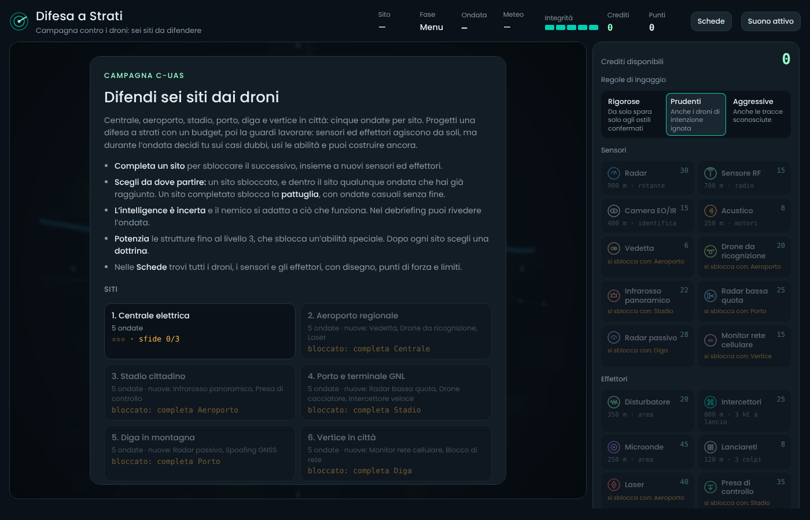
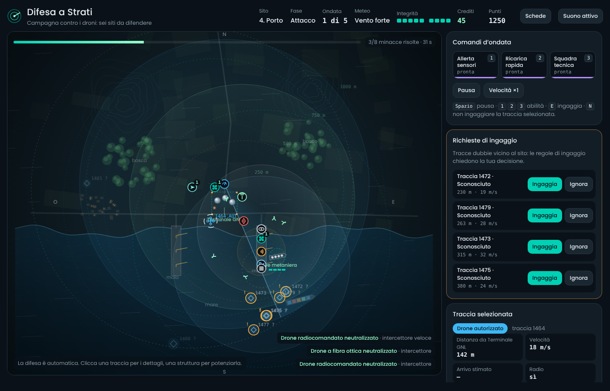
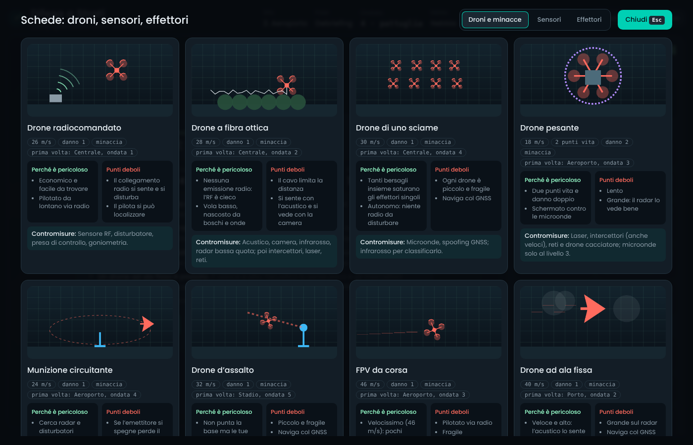
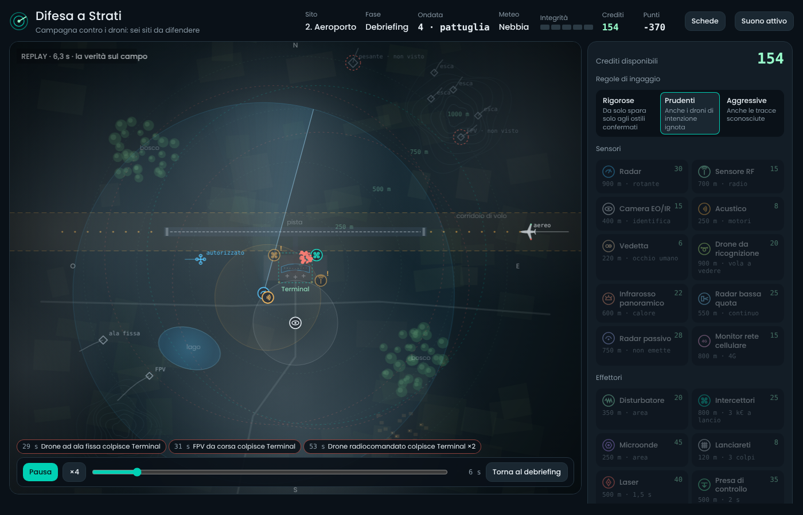
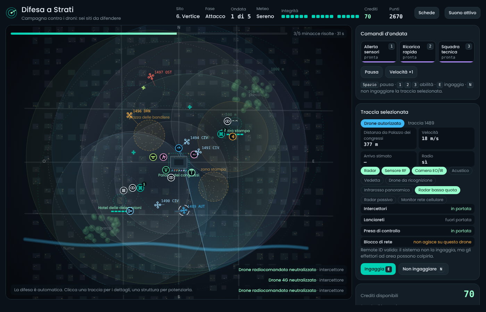

# Difesa a Strati

Gioco didattico sulle **contromisure anti-drone (C-UAS)**, in italiano. Si progetta una difesa a strati con sensori ed effettori, poi la si guarda lavorare contro ondate di droni: il sistema è automatico, ma durante l'ondata il giocatore decide sui casi dubbi, usa le abilità e può costruire ancora.

È un unico file HTML che funziona **offline**: niente rete, niente librerie esterne, font incorporati. Basta aprirlo con un doppio clic.

> Gioco concettuale e didattico: portate, costi ed effetti sono semplificati per spiegare i concetti. Non contiene dettagli operativi reali.



## ▶ Gioca subito

**[Gioca nel browser](https://emabo97.github.io/c-uas-defence/)**: sostituisci nell'indirizzo il tuo nome utente GitHub e il nome del repository. Per attivare il link segui i passi in [Pubblicare con GitHub Pages](#pubblicare-con-github-pages).

Per giocare offline scarica [`difesa-c-uas.html`](difesa-c-uas.html) e aprilo con un doppio clic in Chrome, Edge o Firefox.

## Contenuti

| Contenuto | Dettagli |
|---|---|
| **Campagna** | 6 siti da 5 ondate: centrale elettrica, aeroporto, stadio, porto, diga in montagna, vertice in città. Ogni sito completato sblocca il successivo e nuove strutture. |
| **Pattuglia** | Ondate generate a caso, sempre più difficili, su ogni sito completato. Il record viene salvato. |
| **Droni** | 16 tipi di droni e oggetti in volo: radiocomandati, a fibra ottica, sciami, pesanti, munizioni circuitanti, FPV, ala fissa, furtivi, 4G, spia, d'assalto, drone madre, esche, civili, autorizzati, aerei. |
| **Difese** | 10 sensori e 10 effettori, ognuno potenziabile fino al livello 3. |
| **Meccaniche** | Intelligence incerta, nemico che si adatta, meteo, eventi (guasti, blackout, elisoccorso, perdita del Remote ID), più obiettivi da difendere, obiettivi d'ondata (cattura, scorta), regole di ingaggio. |
| **Didattica** | Debriefing con lezioni e replay dell'ondata, schede illustrate di droni e difese, sfide per ogni sito. |

| Ondata in corso (porto) | Schede di droni e difese |
|---|---|
|  |  |
| **Replay nel debriefing** | **Vertice in città** |
|  |  |

## Struttura del repository

```
index.html            gioco compilato (per GitHub Pages)
difesa-c-uas.html     stesso gioco, da scaricare e distribuire
src.html              CSS e HTML, con i segnaposto per font e codice
js/                   codice del gioco, unito in ordine alfabetico
fonts/                sottoinsiemi del font Poppins
build.py              compila i sorgenti nei file HTML
bot.js, plans.js      giocatore automatico e difese di prova
test-strategie.js     test di bilanciamento con Playwright
docs/SVILUPPO.md      regole, dati, bilanciamento, architettura
```

## Compilare e testare

Servono Python 3 e, per i test, Node.js 18 o successivo.

```bash
python3 build.py              # rigenera index.html, difesa-c-uas.html e test.html

npm install                   # installa Playwright
npx playwright install chromium
npm test                      # compila e gioca tutte le mappe con il bot
```

Il test controlla tre cose:
- su ogni sito una difesa ingenua perde e una ragionata prende 3 stelle;
- la campagna completa arriva a 18 stelle su 18;
- la pattuglia e il replay funzionano senza errori JavaScript.

Gli screenshot finiscono in `shots/`, che non viene caricata nel repository.

Il codice si modifica nei file in `js/` e in `src.html`; poi `python3 build.py` rigenera i file HTML. I dettagli sono in [docs/SVILUPPO.md](docs/SVILUPPO.md).

## Pubblicare con GitHub Pages

Bastano tre passi, da fare una volta sola:

1. Nel repository apri **Settings → Pages**.
2. In **Build and deployment → Source** scegli **Deploy from a branch**. Come branch scegli `main` e come cartella `/ (root)`, poi premi **Save**.
3. Dopo uno o due minuti, in cima alla stessa pagina compare l'indirizzo del gioco, del tipo `https://nome-utente.github.io/nome-repository/`. Copialo nel link "Gioca nel browser" all'inizio di questo README.

Il gioco è `index.html` nella radice del repository. Il file vuoto `.nojekyll` fa servire i file così come sono, senza elaborarli. Con un account gratuito GitHub Pages funziona solo per i repository pubblici.
